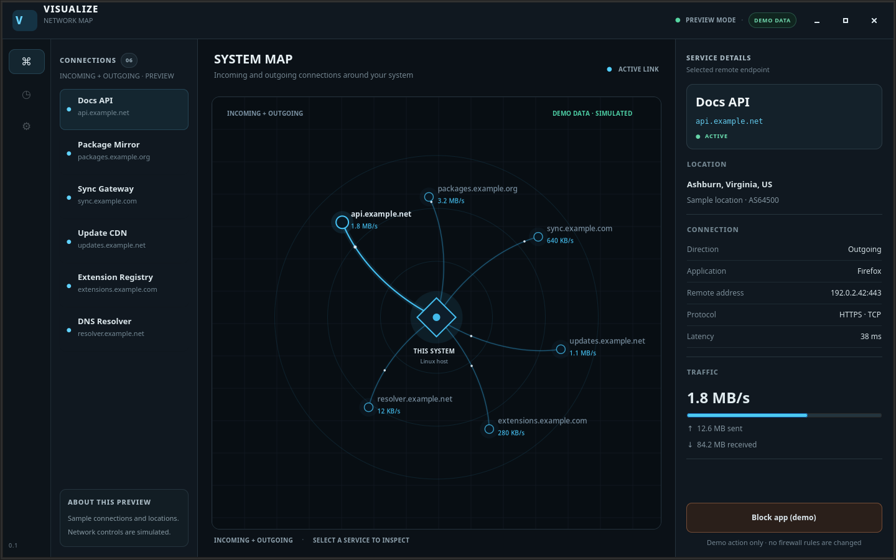
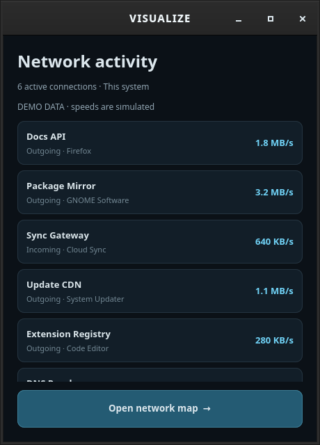

# VISUALIZE · Testing v1

Native GTK4 interface preview for Linux / Xfce. Captured from the running application under Xvfb on 2026-10-29. This is a preview milestone, not a production release.

## Network map

Readable service labels, incoming and outgoing animated links, service details, and an app blocking preview.



## Compact panel

A compact list of services, their direction and sample speeds, with an action to open the full map.



## Validation

- Six automated tests passed: sample endpoint data, map geometry, service selection, and app-wide simulated blocking/reconnection.
- Both windows launched and were visually inspected under Xvfb.
- Source snapshot: `589d4da`.
- Hardware rendering, desktop theme integration, and tray positioning require an actual Xfce session check. Xvfb emits graphics warnings; current GTK also warns about the legacy dark-theme preference.

All traffic, locations, and blocking actions are simulated. Live collection and firewall enforcement are pending.

Run from the repository root:

```sh
PYTHONPATH=src python3 -m visualize
xvfb-run -a env PYTHONPATH=src /usr/bin/python3 -m unittest discover -s tests -v
```

[Earlier preview](https://github.com/Zentrix006/VISUALIZE/tree/researching/research)
